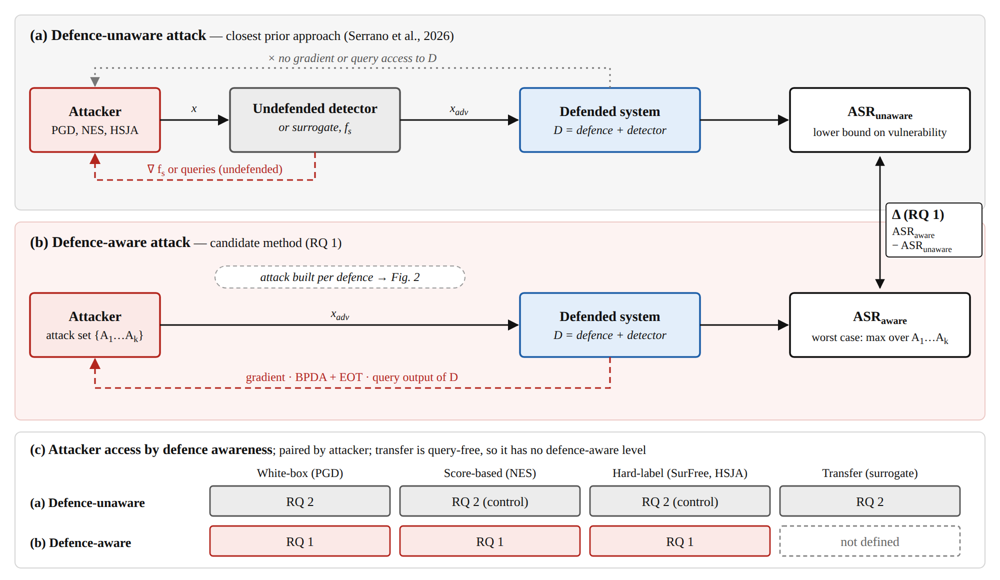
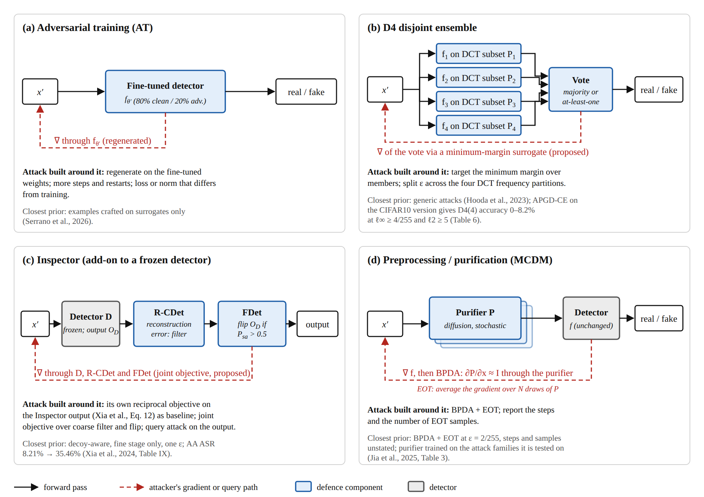
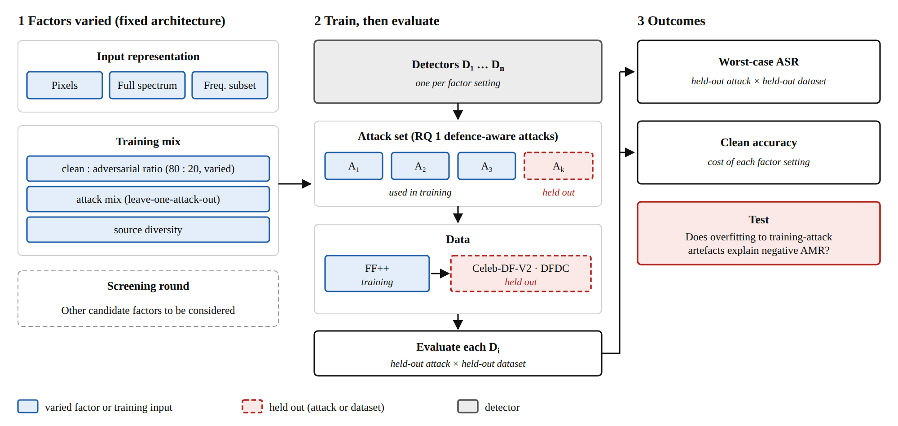

# Research Sketch 
## How Much Robustness Do Face-Forgery Detector Defences Actually Preserve?

Focus: measurement and evaluation design on existing methods. Primary case: face-forgery detection in identity verification for fraud prevention. 

## 1. Problem

### Context

Deepfake detectors are easy to attack. A white-box attack, which has the detector's weights, fooled an Xception detector with 99.85% attack success rate (ASR) on FaceForensics++ (FF++) data (Hussain et al., 2021). Examples made on one Deepfake Detection Challenge (DFDC) detector and submitted to another, with no queries, fooled it 12-99% of the time: the low end for plain white-box examples, the high end for examples built to survive transformations (expectation over transformation, EOT) with larger perturbations (L∞ 0.008-0.018 against 0.005-0.013; Neekhara et al., 2020). Defences exist (adversarial training (AT), frequency-partitioned ensembles, add-on detectors, preprocessing and purification), but the numbers reported for them are not comparable across papers.

Fraud relevance: face is the most-studied biometric in AI identity-fraud detection (Zhang et al., 2026). iProov's chief technology officer states that iProov tracks more than 130 face-swapping tools (Abdullah, 2026, in Fintech News Singapore). Zhang et al. also recommend prioritising adversarial robustness, for example adversarial training, against attacks meant to bypass authentication. No vault paper attacks a deployed verification system, so the fraud setting is just a threat-model choice.

### Problem

Reported defence robustness cannot be compared across papers, is rarely tested against attacks built around the defence, and has no tested explanation for what makes it transfer.

### Research focuses

1. **Not comparable, no spread.**

Each paper picks its own detector, data, perturbation budget and attacker. The budget is ε = 16/255 in Hussain et al. (2021), 9/255 in Serrano et al. (2026) and ℓ2 = 10 in Hooda et al. (2023), who test each attack on only 100 images. None of Hooda, Hussain, Neekhara, Kawa (audio, not faces) or Serrano reports an interval or standard deviation for ASR or equal error rate (EER), and Xia et al. (2024) gives only single numbers. Abbasi et al. (2025) try one weak attack (fast gradient sign method, FGSM, ε = 0.01) with no defence and no spread; accuracy falls by 8.6-11.2 points across four detectors. Training on one dataset and testing on another (e.g. FF++ → Celeb-DF version 2 (Celeb-DF-V2), DeepFake Detection dataset (DFD) and DFDC) is the standard benign protocol (Peng et al., 2025).

2. **The attack is rarely built around the defence.**

Serrano et al. (2026) experiments on undefended surrogates, so the defence is never attacked; Kawa et al. (2023, audio) do not say whether theirs were regenerated against the fine-tuned model. Jia et al. (2025) give mostly gray-box tables and one adaptive table (backward pass differentiable approximation (BPDA) with EOT, ε = 2/255; steps and samples unstated). Closest is Xia et al. (2024): an attack aware of the decoy raises the AutoAttack (AA) success rate from 8.21% to 35.46%, and raises it for two other attacks, but lowers it for FGSM and PGD-40; it is tested at one ε and on the fine stage only.

3. **What makes robustness transfer is untested.**

In Serrano et al. (2026), AT sometimes made detectors more vulnerable on a new dataset (negative attack-mitigation rate). The authors suspect overfitting to the training attacks but did not test it. Hooda et al. (2023) credit their ensemble's robustness to frequency redundancy, based on a random-subset test, and evaluate D4 on diffusion images.

## 2. Research Questions

Gap status and methods are judged only against the papers reviewed; a literature search outside them is needed before any novelty claim. Attacker types (white-box, black-box, transfer), surrogate, and defence-aware versus defence-unaware are defined in section 8 (Attack types).

### RQ 1: Do the defences still hold when the attack is built against the defended system rather than the undefended detector?

#### Core contribution, focus on defence-aware evaluation

- **Approach.** For each defence, run the attack with the defended system in the attacker's loop and report the gap to the defence-unaware ASR, using the worst case over several such attacks.
- **Gap status.**
  - *Attack built around the defence on a face-forgery detector:* **partly covered.** Xia et al. (2024): decoy-aware, fine stage only. Jia et al. (2025) also attack the Inspector with an adaptive attack (BPDA+EOT) and it does worse than their purifier, but they do not say whether the attack passes through the coarse stage. No hard-label or coarse-stage-aware attack found. Why it matters: a defence tested only on undefended-detector attacks gives a lower bound on vulnerability, not evidence of robustness (personal inference).
  - *Add-on defence against AT and ensembles on one grid:* **not found yet.** Why it matters: without one grid, defences cannot be ranked.

### RQ 2: Under a stated threat model, how large is the robustness gap, with what uncertainty, and how much does it move with attacker type, ε and test-set size?

#### Support, focus on measurement

- **Gap status.** *Attackers (white-box, hard-label, transfer) compared on the same detectors, with and without defence, with intervals:* **partly covered; not found together.** Why it matters: with only 100 test images from Hooda et al. (2023), an ASR of 28% could really be anywhere from about 19% to 37% (±9 points, 95% Wald interval, a standard formula). A 5-point gap between two defences is smaller than that noise, so it can't be trusted. Reporting every ASR with an interval shows which gaps can be trusted.

### RQ 3: Which properties of a defence predict worst-case ASR on a held-out attack and a held-out dataset?

#### Extension, focus on what predicts robustness that transfers

- **Setting A (primary): features and training data.** Input representation (pixels, full spectrum, frequency subset) and training mix (attack mix, clean-to-adversarial ratio, source diversity). Does overfitting to training-attack artefacts explain negative attack-mitigation rate (AMR)?
  - *Gap status:* **partly covered** (Serrano et al., 2026; Hooda et al., 2023). Serrano already drops one attack at a time from ensemble AT and finds the success rate rises, so leave-one-attack-out is not new; the overfitting explanation and the input representation are untested. Why it matters: it explains when a defence's reported robustness will not survive a new attack or dataset.
- **Setting B (secondary): ensemble diversity.** Using members from setting A, does pairwise transfer between members predict ensemble ASR, and does a diverse ensemble beat one adversarially trained model at equal cost?
  - *Gap status:* **pairwise transfer measured** (Neekhara et al., 2020; Kawa et al., 2023, audio); link to ensemble ASR not found. Why it matters: it decides whether ensembles are worth their cost.

## 3. Methods

### Shared design

Every attack is described by two terms (full definitions in section 8): **Access** is what the attacker can reach (weights, queries, or only a surrogate), and **Awareness** is whether the defence is part of what the attack is built against.

One grid for experiments: detector × defence × attacker × ε × shift. RQ 2 runs it with defence-unaware attacks and intervals, RQ 1 repeats it with defence-aware attacks, and RQ 3 explains the RQ 1 worst case.

| Factor | Levels |
|---|---|
| Detector | One or two face-forgery architectures (Xception: Hussain et al., 2021; Serrano et al., 2026; Xia et al., 2024) |
| Defence | None; AT (Serrano et al., 2026); disjoint-ensemble deepfake defence (D4), a frequency-partitioned ensemble (Hooda et al., 2023); Inspector for face forgery detection (Xia et al., 2024); preprocessing (Abed et al., 2025); masked conditional diffusion model (MCDM) purification (Jia et al., 2025) |
| Attacker | White-box projected gradient descent (PGD) (worst case); hard-label query (SurFree, HopSkipJump attack (HSJA); Hooda et al., 2023); score-based query (natural evolution strategies (NES); Hussain et al., 2021); transfer from a surrogate (Neekhara et al., 2020), including ensemble-gradient and momentum transfer and latent-space inversion, where all were tested on undefended detectors only (Battiato et al., 2025). A blind-detector protocol, where the attacker never sees the evaluated detector (Battiato et al., 2025: a ViT-B-16 and a DCT-feature DenseNet121 withheld), is a held-out-detector level |
| ε / budget | ε sweep; query budget for query attackers |
| Shift | Clean; H.264 video codec (Hussain et al., 2021); JPEG and blur (Hooda et al., 2023); FF++ compression level 23 (C23) → compression level 40 (C40) (Peng et al., 2025, Table 11); FF++ → Celeb-DF-V2 (Serrano et al., 2026) |

Which attacker is realistic depends on what the system exposes, so the grid compares them rather than assuming one. All defences are re-implemented on face data; D4's published results are on non-face images.

### RQ 1 (core): defence-aware attacks

Defence-aware means the defended system is in the attacker's loop (section 8, Attack types, Awareness).

*Figure 1. (a) The defence-unaware attack crafts on an undefended surrogate and measures ASR on the defended system. (b) The defence-aware attack keeps the defended system in the attacker's loop and reports the worst case over an attack set; the gap between the two is the RQ 1 quantity. (c) Which attacker types each RQ covers.*

Attack built around each defence (general adversarial-ML practice):

| Defence | Attack built around it | Closest prior work |
|---|---|---|
| AT | Regenerate against the fine-tuned weights; more steps and restarts; different loss or norm than in training | Serrano et al. (2026): surrogate-crafted only |
| D4 ensemble | Target the combined decision (minimum margin over members); split budget across partitions | Hooda et al. (2023): generic attacks on diffusion-generated bedroom images, not faces; an appendix gradient attack on a CIFAR10 version breaks D4 almost completely (the single-model baseline breaks too) |
| Inspector | Its decoy-aware reciprocal objective (Xia et al., Eq. 12) as baseline; a joint objective over the coarse score and the flip; a query attack against the combined output | Xia et al. (2024): one ε, fine stage only; Jia et al. (2025) run BPDA+EOT against it, coarse-stage handling unstated |
| Preprocessing or purification | EOT (Hussain et al., 2021); for a stochastic purifier, BPDA+EOT as in Jia et al. (2025, Table 3), with steps and samples reported | Jia et al. (2025): purifier trained on the attack families it is tested on; identity preservation untested |

*Figure 2. The attacker's gradient or query path (dashed) for each defence: (a) adversarial training, (b) D4 disjoint ensemble, (c) Inspector, (d) preprocessing or purification.*

Report the worst case over these, with the spread between attacks.

### RQ 2: measurement with intervals

The grid above with defence-unaware attackers: white-box PGD, hard-label, score-based, and transfer (section 8, Awareness, Access). Bootstrap interval over test items and spread over training seeds. Closest prior work experiments attackers but no defence or no spread: Hussain et al. (2021); Neekhara et al. (2020); Abbasi et al. (2025); Hooda et al. (2023).

*Caveat: The score-based and hard-label attackers query the undefended detector and the result is submitted to the defended system, so they are controls paired with RQ 1's query attacks on the defended system, with the same query budget; they are not the realistic black-box attacker.*

### RQ 3: what predicts transfer

**Setting A.**  Architecture fixed; only the input representation varies: pixels, full spectrum, or frequency subset. For subsets, compare random vs saliency-ordered selection (motivated by Hooda et al., 2023, who show ~6% of random frequencies still detect well). Training mix: the clean/adversarial ratio varies around the 80/20 split of Serrano et al. (2026), and each attack is held out of training in turn (leave-one-attack-out, as Serrano et al. do for ensemble AT, here extended to the other factors).

Outcome: worst-case ASR on a held-out attack and dataset, plus clean-accuracy cost (as in Kawa et al., 2023, who work on audio).

*Figure 3. RQ 3 setting A: factors varied on a fixed architecture, trained and evaluated against held-out attacks and datasets, and expected outcomes.*

*Further candidate factors.* The generalization literature lists the levers below, mostly evaluated on benign shift, so their effect under attack is untested. 

| Group | Candidate factors |
|---|---|
| Data augmentation | Identity removal or masking; random masking and block shuffling; Gaussian blur; simulated compression and degradation; contrastive pairs |
| Multi-source learning | Training on several manipulation methods or datasets; incremental learning; common-feature extraction across forgery methods |
| Fingerprints | Passive GAN-fingerprint cues |
| Feature enhancement | Spatial-frequency fusion; attention; resynthesis and reconstruction residual cues; blending-boundary cues; knowledge distillation |
| Temporal and audio-visual (beyond image-based detectors) | Inter-frame motion, mouth or eye cues, audio-visual consistency; needs video or audio input and a different architecture |
| Vision-language | CLIP or VLM-based detectors (different architecture class) |

**Setting B.** 

Members come from setting A's models. Diversity is pairwise transfer rate (the success of examples crafted on one member against another, i.e. the transfer attack of section 8); compare ensemble ASR with a single adversarially trained model at matched cost. 

Closest prior work: Hooda et al. (2023), Neekhara et al. (2020), Kawa et al. (2023).

## 4. Evaluation & Baseline

### Data

| Role | Dataset | Note |
|---|---|---|
| Training | FF++ | Used by Hussain et al., Serrano et al., Xia et al., Jia et al. |
| Held-out | Celeb-DF-V2 | Serrano et al. protocol; benign FF++ → Celeb-DF area under the receiver operating characteristic curve (AUC) is about 70% (Peng et al., 2025, Table 9), so some drop occurs without any attack |
| Further held-out | DFDC | Used in Hussain et al. and Neekhara et al. |
| Identity-verification candidate | electronic know-your-customer deepfake set (eKYC-DF) | 228,760 videos in total, 760 of them real (so about 228,000 fake by subtraction); SimSwap, FaceDancer, SberSwap; injection-attack threat model; benign evaluation only, no adversarial attack (Felouat et al., 2024, Secs. III-V) |
| Optional | StarGAN-CelebA, StyleGAN-FFHQ (generative adversarial network (GAN) image sets, Xia et al., 2024) | Not verification captures |
| Later option | Audio set | Replication after Kawa et al. (2023) |

Public identity-fraud datasets are small or lab-controlled, and synthetic ones show generator-specific bias (Zhang et al., 2026). None of the above are selfie or document-capture conditions, so the results will show how detectors behave on these benchmarks, not that a defence holds against fraudsters. This is the current limitations.

**Sanity checks (all RQs).** 

ASR should rise with ε and white-box should be at least as strong as black-box; FGSM weakens as ε grows for two audio models (Kawa et al., 2023), so check rather than assume. 

Low ASR under a weak attack is a lower bound on vulnerability, not evidence of robustness. Use one AMR baseline per case: Serrano et al., 2026, report AMR that does not follow the Base row (PGD adversarial training in C5: ASR 58.4 against a Base row of 53, yet AMR +10.3).

### RQ 1

- **Metrics.** Worst-case ASR over defence-aware attacks, because an average would hide the strongest attacker; the gap to the RQ 2 ASR for the same defence; clean accuracy and latency per defence, as the cost of the defence; false-reject rate on real images alongside ASR on fakes, because robust accuracy on forged images alone (Jia et al., 2025, Sec. 4.1.5) can rise when more images are labelled fake, and for fraud a rejected legitimate customer is a cost.
- **Data.** FF++ for training, Celeb-DF-V2 held out.

| Defence | Defence-unaware (reported) | Defence-aware (reported) | Source |
|---|---|---|---|
| Inspector, Xception, AA, ε = 2/255 | 3.43% ASR; 8.21% when attacking the forgery detector alone | 35.46% when the attack targets the Inspector's outputs; 44.13% when attacking detector plus Inspector together | Xia et al. (2024). The paper does not explain why its two defence-unaware numbers differ. With the decoy mechanism removed the Inspector fails (99.67%), but that tests the defence's design, not a stronger attacker |
| MCDM purifier, robust accuracy (ResNet-50 / Xception / EfficientNet-b0) | Gray-box tables | 84.34 / 80.12 / 78.45 under BPDA+EOT, ε = 2/255 (Table 3) | Jia et al. (2025); steps and samples unstated |
| D4(4) ensemble, CIFAR10 version | None reported | Generic hard-label queries on the defended detectors (defence-aware, not built around the defence; diffusion images, Table 1): D4(4) ASR 0-28%; adversarially robust deepfake detection with adversarial training (ARDD-AT) 18-97%. Gradient attack (APGD-CE) on the CIFAR10 version: accuracy 0-8.2% at ℓ∞ ≥ 4/255, ℓ2 ≥ 5 | Hooda et al. (2023); neither dataset is faces |
| AT, Dataset, Utility, Model, Backbone transferability benchmark (DUMB) C1 / C3 / C5 / C7 | ASR 85.7 / 68.7 / 53 / 55.8 (no defence; average over PGD, FGSM and FPBA attacks) | PGD AT: 20.2 / 34.2 / 58.4 / 59.9 (same attack average, surrogate-crafted) | Serrano et al. (2026) |

### RQ 2

- **Metrics.** ASR with a bootstrap interval over test items and spread over training seeds, because single numbers cannot rank defences; robust accuracy against ε, to show how fast a defence breaks; ASR against the detector's clean miss rate on the same fakes (the AADD-2025 report omits it), and structural similarity index measure (SSIM) next to ε, since that challenge scored SSIM rather than a norm budget (Battiato et al., 2025, Sec. 3.3).
- **Data.** The same grid and shift axis, with the interval method applied to every cell.

| Reference | Reported | Source |
|---|---|---|
| Undefended Xception, FF++, white-box, ε = 16/255 | 99.85% ASR, raw frames, non-robust attack (Table 2); 80.39% under H.264 compression (C = 40), robust attack with EOT (Sec. 4.1, Table 4: 99.91% raw). Frame-level success | Hussain et al. (2021) |
| Undefended, DFDC detectors, transfer | 12.0-94.0% plain white-box examples (Table 3); 33.5-99.0% transfer attack with EOT (Table 4) | Neekhara et al. (2020) |
| Undefended, ε = 9/255, PGD; C1 and C3 tested on FF++, C5 and C7 on Celeb-DF-V2 | 99.6 / 89.8 / 65.1 / 66.7% (C1 / C3 / C5 / C7); FGSM 71.7 / 56.5 / 48.4 / 49.2% | Serrano et al. (2026) |
| Four detectors, FGSM ε = 0.01 | Accuracy falls 8.6-11.2 points (DFDC) | Abbasi et al. (2025, Table 3) |

### RQ 3

- **Metrics.** Worst-case ASR on a held-out attack and a held-out dataset (leave-one-attack-out), so a defence cannot score well by memorising training attacks; clean-accuracy cost; for setting B, rank correlation between pairwise transfer and ensemble ASR (personal inference).
- **Data.** FF++ → Celeb-DF-V2 and DFDC.

| Reference | Reported | Source |
|---|---|---|
| AT, cross-dataset | AMR from −36.6 to +14.4 (C5), −34.1 to +18.9 (C7) across strategies | Serrano et al. (2026, Table 3) |
| Audio (not faces); AT with an adaptive training schedule, not an adaptive attack | White-box EER 0.7870 → 0.1247; clean EER 0.0227 → 0.0882 | Kawa et al. (2023) |
| Purifier clean cost | ResNet-50 95.43% → 91.67%; 33 images per ten seconds on an RTX 3090 | Jia et al. (2025) |
| Benign shift FF++ C23 → C40 | AUC 82.52 to 97.97 across methods | Peng et al. (2025, Table 11) |

## 5. Potential Contribution

| RQ | Contribution |
|---|---|
| RQ 1 | Worst-case ASR for each defence under attacks built around it, with the gap to the defence-unaware number, on one grid |
| RQ 2 | A comparable measurement protocol: shared grid, threat model, ε sweep, and intervals, with the sample size at which differences become distinguishable |
| RQ 3 | A test of which features, training mix, and ensemble diversity predict robustness that transfers |
| Option (after RQ 3) | Train a detector with the best RQ 3 settings and run it through the RQ 1 defence-aware attacks. Test if a detector built from the RQ 3 findings holds up better against attacks designed to beat it. |

## 6. Plan

| Milestone | Deliverable |
|---|---|
| **M1 (6 months)** | Threat model and grid fixed; one or two detectors trained on FF++ and clean baselines reproduced; undefended attackers (white-box, hard-label, transfer) run with intervals; defences re-implemented. Datasets decided. |
| **M2 (1 year)** | RQ 1 core method (defence-aware attacks per defence) implemented and reaching, or close to, the published defence-aware numbers on the same defences; attack revised if it does not. RQ 2 intervals for the full grid. |
| **M3 (1.5 years)** | RQ 3 setting A and B complete; held-out attack and dataset results; release protocol for the attack code; write-up. |

Milestones are a proposal to be edited.

## 7. Risks

- **Weak attacks** repeat the problem being critiqued: ASR on ARDD-AT ranges from 18 to 97 across six attacks (Hooda et al., 2023, Table 1), and a single FGSM at ε = 0.01 gives 8.6-11.2 point drops (Abbasi et al., 2025).
- **Fraud framing outruns the evidence.** Benchmarks differ from selfie and document-capture conditions, so a result on them does not show protection against identity fraud; claim only what the benchmarks support (personal inference).
- **Scope and compute.** A full grid with intervals and seeds may exceed one project; D4 is evaluated with a 50,000-query budget per attack (Hooda et al., 2023).
- **Dual use.** Defence-aware attack code is usable offensively; release needs a restricted protocol.

## 8. Terms used

### Attack types: shared definitions

An attack here means crafting an input that a detector labels wrongly (a fake labelled real), under a perturbation budget ε. Attacks are classed by two independent attributes, Access and Awareness, so every grid cell in section 3 names one level of each.

**Access: what the attacker can access** (the class names are general practice, and the wording of access is from Neekhara et al., 2020, Sec. 1).

| Attacker type | What the attacker can access | How the example is made | Used in this sketch |
|---|---|---|---|
| White-box | The target model's architecture and parameters, so its gradients (Neekhara et al., 2020: "complete access to the victim model architecture and parameters") | Gradient steps on the target itself (FGSM, PGD, AA) | PGD, the worst case; Hussain et al. (2021) |
| Black-box, score-based | Queries to the target and its raw scores, no weights (Neekhara et al., 2020) | Estimate the gradient from the scores | NES (Hussain et al., 2021) |
| Black-box, hard-label | Queries to the target and only its predicted class (Hooda et al., 2023) | Search along the decision boundary with a query budget | SurFree, HSJA (Hooda et al., 2023: 50,000 queries) |
| Transfer (black-box, query-free) | No queries to the target; a surrogate instead | Craft with white-box methods on a surrogate, then submit the result to the target | Neekhara et al. (2020); Serrano et al. (2026) |

A *surrogate* is a stand-in model the attacker trains or picks because the target's gradients are not available. 

A *blind-detector protocol* is a held-out level of Access: the attacker never sees the evaluated detector (Battiato et al., 2025).

**Awareness: whether the defence is in the attacker's loop** (my own framing of RQ 1; Xia et al., 2024 call their version "adaptive").

| Level | Definition | Example |
|---|---|---|
| Defence-unaware | The example is crafted on an undefended detector or surrogate (by gradients or by queries to it), then tested on the defended system. A low ASR is only a lower bound on vulnerability. | Serrano et al. (2026): surrogate-crafted examples against adversarially trained detectors |
| Defence-aware | The defended system, including the defence's own parts, is in the attacker's loop. It can be reached by gradients (white-box), by queries to the defended system's output, or by a smooth approximation of a non-differentiable defence (BPDA, EOT). | Xia et al. (2024) Eq. 12: the Inspector's reciprocal output is differentiated; AutoAttack ASR rises from 8.21% to 35.46% |

Access and Awareness combine freely:

- A query attack on the defended system is black-box and defence-aware. This is the realistic black-box attacker.
- The same query attack on the undefended detector, with the result submitted to the defended system, is black-box and defence-unaware. It is a paired control, not a threat model, because an attacker rarely has query access to an undefended copy.
- PGD on the undefended detector is white-box and defence-unaware.

RQ 2 uses defence-unaware attackers of all four types. RQ 1 repeats white-box, score-based and hard-label with the defended system in the loop, so each of these three has a paired cell with the same attack method, ε and query budget. *Open:* transfer is query-free, so a defence-aware transfer level needs a defence-aware surrogate (one that includes the defence), which is not yet defined; until then RQ 1 covers white-box and query attackers only.

### Abbreviations

Each abbreviation used above is written in full here, with its type. Definitions of attack methods and metrics marked "general practice" are not read from a paper; numbers are as cited in the sections below.

| Abbreviation | Full name | Type | What it is |
|---|---|---|---|
| ASR | Attack success rate | **Metric** | Share of fake images the detector labels real after the attack. Higher means a weaker detector. |
| Robust accuracy | Accuracy under attack | **Metric** | Share of attacked inputs the detector still classifies correctly, reported against the perturbation budget. |
| AMR | Attack-mitigation rate | **Metric** | Relative ASR reduction from a defence, (ASR before − ASR after) / ASR before (Serrano et al., 2026). |
| EER | Equal error rate | **Metric** | Error rate at the threshold where the false-accept and false-reject rates are equal. Lower is better; threshold-free, so it compares detectors without picking an operating point. |
| AUC | Area under the receiver operating characteristic curve | **Metric** | Probability that a random fake scores higher than a random real image; 1 is perfect, 0.5 is chance. |
| SSIM | Structural similarity index measure | **Metric** | Perceptual similarity between the attacked and original image, 1 meaning identical (Battiato et al., 2025). |
| ε | Perturbation budget (epsilon) | **Attack setting** | Largest change the attacker may make to each pixel (ℓ∞ norm) or in total (ℓ2 norm). On a 0-255 pixel scale, ε = 2/255 allows at most 2 levels per pixel. |
| ℓ∞ / ℓ2 | Infinity norm / Euclidean norm | **Attack setting** | Two ways to cap the perturbation: no pixel moves more than ε, or the total Euclidean size of the change is capped. |
| FF++ | FaceForensics++ | **Data** | Standard training set: real videos plus fakes from four manipulation methods (Deepfakes, Face2Face, FaceSwap, NeuralTextures; Peng et al., 2025, Table 8). |
| C23 / C40 | FF++ compression levels 23 and 40 | **Data variant** | H.264 compression strength of the FF++ videos (constant rate factor 23 light, 40 heavy); the FF++ convention, not stated in the vault notes. |
| Celeb-DF-V2 | Celeb-DF version 2 | **Data** | Held-out deepfake set used for cross-dataset tests (Serrano et al., 2026). |
| DFD | DeepFake Detection dataset (Google) | **Data** | Deepfake set with 28 individuals and 3,068 deepfake videos, used for cross-dataset tests (Peng et al., 2025). |
| DFDC | Deepfake Detection Challenge dataset | **Data** | Larger deepfake video set used in Hussain et al. (2021) and Neekhara et al. (2020). |
| eKYC-DF | Electronic know-your-customer deepfake set | **Data** | 228,760 videos from three generators (760 real), built for identity verification with head-movement attacker videos and compression levels C0, C23, C40 (Felouat et al., 2024). |
| H.264 | H.264 video codec | **Data transformation** | Lossy video compression, used as a distribution shift (Hussain et al., 2021). |
| FGSM | Fast gradient sign method | **Attack method** | One step: move every pixel by ε in the direction that most increases the detector's loss. Cheap and weak (general practice). |
| PGD | Projected gradient descent | **Attack method** | FGSM repeated for many small steps, clipped back inside the ε ball. Standard worst-case white-box attack (general practice). |
| AA | AutoAttack | **Attack method** | Parameter-free ensemble: two new PGD extensions (APGD with cross-entropy and with difference-of-logits-ratio loss) plus the existing FAB and Square Attack; lower robust accuracy than reported in all but one of over 50 models (Croce & Hein, 2020). |
| SurFree / HSJA | SurFree / HopSkipJump attack | **Attack method** | Hard-label query attacks that see only the predicted class (Hooda et al., 2023). |
| NES | Natural evolution strategies | **Attack method** | Score-based query attack that estimates gradients from detector scores (Hussain et al., 2021). |
| BPDA | Backward pass differentiable approximation | **Attack method** | For a non-differentiable defence, run it forward and replace it with a smooth approximation (often the identity) on the backward pass (Athalye et al., 2018, Sec. 4.1). |
| EOT | Expectation over transformation | **Attack method** | For a random defence or transformation, average the gradient over many draws to get a stable direction (general practice). Hussain et al. (2021) use it so the perturbation survives compression. |
| AT | Adversarial training | **Defence method** | Retrain the detector on a mix of clean and adversarial examples (Serrano et al., 2026: 80% clean, 20% adversarial). |
| ARDD-AT | Adversarially robust deepfake detection with adversarial training | **Defence method** | Baseline defence in Hooda et al. (2023). |
| D4 | Disjoint-ensemble deepfake defence | **Defence method** | Four ResNet50s trained on disjoint frequency subsets of the input (Hooda et al., 2023). |
| Inspector | Inspector for face forgery detection | **Defence method** | Add-on with a coarse detector and a fine detector that flips the output when it judges the input adversarial (Xia et al., 2024). |
| MCDM | Masked conditional diffusion model purifier | **Defence method** | Diffusion purifier placed in front of an unchanged detector (Jia et al., 2025). |
| AADD-2025 | Adversarial Attacks on Deepfake Detectors challenge 2025 | **Benchmark** | Challenge in which participants attacked undefended detectors (Battiato et al., 2025). |
| DUMB | Dataset, Utility, Model, Backbone transferability cases | **Benchmark** | Benchmark of five detectors and transfer cases C1-C7 for adversarial training (Serrano et al., 2026). |

## 9. References

1. Abbasi, M., Váz, P., Silva, J., & Martins, P. (2025). Comprehensive evaluation of deepfake detection models: Accuracy, generalization, and resilience to adversarial attacks. *Applied Sciences*, 15(3), 1225. https://doi.org/10.3390/app15031225
2. Abdullah, I. N. (2026, June 17). If deepfakes can fool the trained eye, what should APAC banks do? *Fintech News Singapore*. https://fintechnews.sg/133084/security/deepfake-fraud-apac-banks-identity-checks-biometric-liveness/ (industry news; author and date from the live page, 2026-10-15).
3. Abed, B. N. A., Hussien, S. A. S., & Majeed, S. H. (2025). Adversarial attacks on deepfake detectors and defence mechanisms: A cyber security model. *IJIES*, 18(3), 730-745. https://doi.org/10.22266/ijies2025.0430.50
4. Athalye, A., Carlini, N., & Wagner, D. (2018). Obfuscated gradients give a false sense of security: Circumventing defenses to adversarial examples. *ICML 2018*. arXiv:1802.00420.
5. Battiato, S., Casu, M., Guarnera, F., Guarnera, L., Puglisi, G., Pontorno, O., Ragaglia, C. V., & Akhtar, Z. (2025). Adversarial attacks on deepfake detectors: A challenge in the era of AI-generated media (AADD-2025). *Proceedings of the 33rd ACM International Conference on Multimedia (MM '25)*, 13714-13719. https://doi.org/10.1145/3746027.3761983
6. Croce, F., & Hein, M. (2020). Reliable evaluation of adversarial robustness with an ensemble of diverse parameter-free attacks. *ICML 2020*. arXiv:2003.01690.
7. Felouat, H., Nguyen, H. H., Le, T.-N., Yamagishi, J., & Echizen, I. (2024). eKYC-DF: A large-scale deepfake dataset for developing and evaluating eKYC systems. *IEEE Access*, 12, 30876-30892. https://doi.org/10.1109/ACCESS.2024.3369187.
8. Hooda, A., Mangaokar, N., Feng, R., Fawaz, K., Jha, S., & Prakash, A. (2023). D4: Detection of adversarial diffusion deepfakes using disjoint ensembles. *WACV 2024*. https://doi.org/10.1109/wacv57701.2024.00377 (read as arXiv:2202.05687v3).
9. Hussain, S., Neekhara, P., Jere, M., Koushanfar, F., & McAuley, J. (2021). Adversarial deepfakes: Evaluating vulnerability of deepfake detectors to adversarial examples. *WACV 2021*, 3348-3357.
10. Jia, C., Wu, Z., Su, C., Liu, H., & Xiao, Y. (2025). Adversarial defense method to face forgery detection based on masked conditional diffusion model. *Expert Systems With Applications*, 287, 128156. https://doi.org/10.1016/j.eswa.2025.128156
11. Kawa, P., Plata, M., & Syga, P. (2023). Defense against adversarial attacks on audio DeepFake detection. *Interspeech 2023* (read as arXiv:2212.14597v2).
12. Neekhara, P., Dolhansky, B., Bitton, J., & Canton Ferrer, C. (2020). Adversarial threats to DeepFake detection: A practical perspective. *CVPR Workshops 2021*. https://doi.org/10.1109/cvprw53098.2021.00103 (read as arXiv:2011.09957v1).
13. Peng, C., Chen, T., Liu, D., Guo, H., Wang, N., & Gao, X. (2025). Revisiting face forgery detection towards generalization. *Neural Networks*, 187, 107310. https://doi.org/10.1016/j.neunet.2025.107310 (survey).
14. Serrano, A., Umlil, E., & Thomas, R. (2026). Deepfake detectors are DUMB: A benchmark to assess adversarial training robustness under transferability constraints. arXiv:2601.05986v1 (preprint).
15. Xia, R., Zhou, D., Liu, D., Li, J., Yuan, L., Wang, N., & Gao, X. (2024). Inspector for face forgery detection: Defending against adversarial attacks from coarse to fine. *IEEE TIP*, 33, 4432-4443. https://doi.org/10.1109/TIP.2024.3434388
16. Zhang, C., Gill, A. Q., Liu, B., & Anwar, M. (2026). AI-based identity fraud detection: A systematic review. *Applied Artificial Intelligence*, 40(1), e2731995. https://doi.org/10.1080/08839514.2026.2731995
