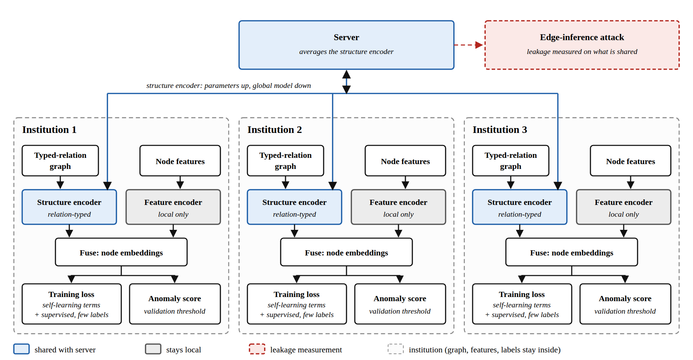
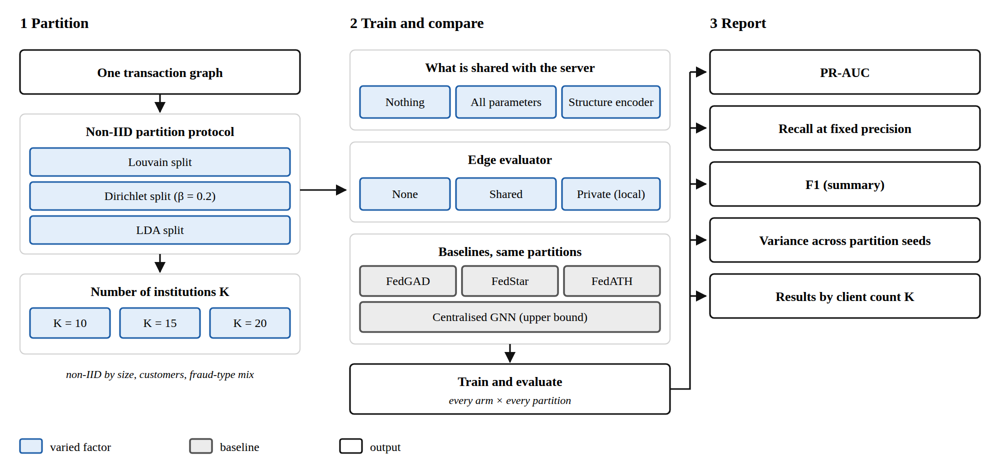

# Sketch
## Federated Graph-Based Anomaly Detection for Financial Institutions

## 1. Problem

### Context

Banks and payment providers each see part of the same fraud network. Mule accounts, laundering chains, and scam rings often cross institution boundaries, but each institution trains only on its own transaction graph, so cross-institution structure is missed. Centralising such data is limited by privacy concerns, regulatory restrictions, and commercial competition (He et al., 2021).

### Problem

**Detect anomalous accounts and transactions across several institutions, each holding a partial graph, without sharing raw records.**

### Research focuses

The review of GNN fraud detection in this set (33 included studies) contains no federated-learning content (Motie & Raahemi, 2024), and no federated graph fraud model was found in the papers reviewed. Three focuses are taken up as RQs; a fourth is a setting extension.

1. **Heterogeneity.**

Institutions differ in customers, feature schema, label definitions, and class balance. Non-IID data can degrade federated performance (Sana et al., 2025). For graphs, non-IID arises in both data distribution and topology: node degrees, edge weights, edge types, and structures (Liu et al., 2025). Chen et al. (2025) describe heterogeneous features across institutions as unaddressed in earlier federated fraud detection. Fu et al. (2025) define topology heterogeneity as same-class nodes being linked to different classes on different clients, and report that two recent graph methods do not consistently reduce the resulting embedding divergence (their method is evaluated only on supervised node classification).

2. **Privacy.**

Sharing an interclient graph to repair local graphs may leak other clients' private information (Liu et al., 2025), and model weights may still leak (He et al., 2021). FedGAD (Fang et al., 2026) passes node embeddings through the server for cross-client reconstruction and reports no leakage analysis.

3. **Rare topologies.**

A fraud typology is a named scheme (mule chain, star-shaped collection account, laundering cycle; the list is a personal inference). Its topology is the shape it takes in the graph. Rare typologies therefore have rare topologies. Labelled fraud is scarce and often arrives after the fraud has happened (Zhang et al., 2026, in identity-fraud detection). Park et al. (2025) report localised fraud patterns diluted in federated gradient boosting. None of the graph papers reviewed tests typology-level rarity.

4. **Setting extension: entity alignment.**

The same account can appear at several institutions, so cross-institution edges need a matching step, which is itself a privacy problem. FedGAD, the closest work, assumes institutions share no overlapping nodes (Fang et al., 2026). Alignment is treated as an optional extension, not an RQ, because matching needs shared identifiers and may not be feasible.

## 2. Research Questions

Gap status and methods are judged only against the reviewed papers. A full-text review is needed before any novelty claim.

### RQ 1: Can a federated graph model detect fraud better than baseline models when institutions differ in customers, relation types, and label definitions?

#### Core contribution, focus on heterogeneity

- **Gap status: partly covered.** Structure sharing (FedStar), cross-client reconstruction (FedGAD) and edge pruning by a private evaluator (FedATH; Fu et al., 2025) handle heterogeneity without relation types. FedATH treats edges as untyped and binary, and its edge evaluator scores endpoint features, so it plausibly needs one feature space across clients (personal inference; Fu et al. do not state this). FedCAD (Kong et al., 2025) is unsupervised and applies only to homogeneous graphs. Typed relations appear only in centralised models (Li et al., 2025a). Closest evidence: FedStar, FedGAD, FedATH, FedCAD, Li et al. (2025a).
- **Why it matters.** Fraud graphs carry typed relations (transfers, shared devices, business roles); an untyped structure channel discards them (personal inference). No cited paper tests whether keeping relation types helps in a federated setting; Li et al. (2025a) uses them only in a centralised model, so RQ 1 has to establish this.

### RQ 2: Can institutions share what the model needs without exposing information about their customers' relationships?

#### Support, focus on privacy

- **Gap status: partly covered.** Yang et al. (2026) measure edge inference in federated GNNs, but only for a poisoning client, on citation, author and movie benchmark graphs. Leakage from the quantities shared here, on fraud graphs, and its privacy-versus-accuracy cost are not found as a result. Closest evidence: Yang et al. (2026), FedGAD, FedStar, Ghourabi & Khaldi (2026).
- **Why it matters.** "No raw data shared" is the setting's premise; an unmeasured privacy claim can break that premise.

### RQ 3: Can the model detect fraud whose network structure is rare within and across institutions?

#### Extension, focus on rare topologies

- **Gap status: partly covered.** Prototype reliability is designed for noisy, heterogeneous clients and has been checked on rare classes only through per-class F1, not on rare topologies. Label-scarce supervised work is centralised; FedCAD (Kong et al., 2025) needs no labels but is not tested on rare topologies. Closest evidence: FedProD, Park et al. (2025), Li et al. (2025b), FedCAD.
- **Why it matters.** Rare typologies are the cases institutions most need others' data for (personal inference).

### Setting extension: entity alignment

The three RQs are posed without entity alignment. When entity matching is available, they are re-run and evaluated.

- **Gap status: not found.** FedGAD assumes no overlapping nodes (Fang et al., 2026). FedCAD assumes overlapping nodes and intersects pseudo-labels across clients by node position, but does not say how nodes are matched or what the matching reveals (Kong et al., 2025). No paper in the set measures alignment errors.
- **Why it matters.** Banks share customers, so the no-overlap assumption fails for them.

## 3. Methods

### Shared design

**Learning setting, in priority order.** Each institution has a few confirmed fraud labels and a large unlabelled graph.

1. **Self-learning (highest priority).** Train from the unlabelled graph itself with self-generated targets such as contrastive or propagation terms, and use the few labels only to fix the threshold and to check results (RQ 3 also uses them to build fraud prototypes). Label-scarce centralised precedents exist (Li et al., 2025b; Xiang et al., 2023), but no federated version was found in the papers reviewed.
2. **Unsupervised.** No labels in training. This version would mostly overlap FedGAD (Fang et al., 2026), so it is the fallback and a baseline, not the contribution.
3. **Supervised (lowest priority).** A loss on labelled accounts. This version would overlap labelled federated fraud work (Chen et al., 2025; Park et al., 2025), so it has the lowest priority.

### RQ 1 (core): shared structure with relation types, local features

| Variant | What it shares | Source | Difference |
|---|---|---|---|
| Local only | Nothing | Baseline | No cross-institution structure |
| FedAvg GNN | All parameters | McMahan et al. (2017) | Feature schema must match |
| FedStar | Structure encoder only; feature encoder local | Tan et al. (2023) | Graph classification; no relation types |
| FedGAD | Cross-client neighbour reconstruction | Fang et al. (2026) | Unsupervised; embeddings pass through the server |
| FedATH | Causal-subgraph GNN only; edge evaluator and biased GNN local | Fu et al. (2025) | Supervised node classification on citation, co-purchase and Wikipedia graphs; untyped edges; no leakage analysis |
| FedCAD | Pseudo-labels and neighbour embeddings of flagged nodes, swapped across clients for nodes flagged on both | Kong et al. (2025) | Unsupervised; homogeneous graphs; needs aligned nodes; clients made by random node sampling, with injected anomalies; no leakage analysis |
| FedGATSage | Community overlay on a server-side GraphSAGE | Al Tfaily et al. (2025) | IoT flow data; informal privacy |
| **Candidate** | Structure encoder extended with relation types; features local | Tan et al. (2023); typed relations as in Li et al. (2025a), centralised | Typed relations in a federated structure channel |

Closest prior works and their overlap: FedGAD (direct overlap, banks used only as illustration, no bank data), FedStar (heterogeneity and structure sharing), FedATH (topology heterogeneity by sharing only the causal subgraph model; supervised, untyped edges), FedCAD (cross-client anomaly information, but homogeneous and dependent on shared nodes), Li et al. (2025a) (typed relations, centralised), and Chen et al. (2025) (federated transfer under heterogeneous features, non-graph).

**Design option from FedATH.** Keep the edge evaluator, which scores and prunes edges, inside each institution, as FedATH does, but score each relation type separately. No edge scores leave the institution. Fu et al. (2025) find that sharing the evaluator lowers accuracy on Photo and WikiCS, which is why it stays local. The risk is that the evaluator drops the few mule or collusion links that carry fraud signal, so report how many known fraud edges get pruned.

### RQ 2: Privacy: controlled sharing

Only the structure encoder, prototypes, and gradients cross institution boundaries, and each is measured for leakage; privacy is a constraint on the method, not a separate contribution. The threat model is an honest-but-curious institution that follows the agreed training procedure and tries to infer other institutions' relationships from what it receives. Yang et al. (2026) instead study a poisoning client that breaks the protocol. That attack falls outside this threat model.

In the entity alignment extension, the matching step is part of this boundary and must state what crosses it (node embeddings, edge aggregates, or gradients). FedCAD shows the dependency: its cross-client swap works only for nodes identified on both clients, and uploading pseudo-labels with node positions tells the server which nodes each client considers anomalous (Kong et al., 2025). One candidate is matching on hashed, salted identifiers within a consortium, which needs a re-identification check before use (personal inference).

| Shared quantity | Attack | Why |
|---|---|---|
| Structure encoder parameters | Edge inference | Weights may leak (He et al., 2021). Yang et al.'s white-box attacker sees the global parameters but not other clients' updates |
| Causal GNN weights (FedATH-style) | Edge inference | The only uploaded component in Fu et al. (2025), which reports no leakage analysis |
| Prototypes | Membership or edge inference | Fraud prototypes rest on few labels and may be re-identifying (personal inference) |
| Gradients | Edge inference | Same exposure as the weights they update (personal inference). Yang et al.'s attacker sees only its own updates |
| Global model outputs and parameters | Edge inference by a poisoning client | Yang et al. (2026) recover cross-client links on benchmark graphs; poisoning detectors only partly stop it |
| FedCAD-style pseudo-labels and flagged-node neighbour embeddings | Membership or edge inference | Reveal which nodes a client flags; Kong et al. (2025) report no leakage analysis |
| FedGAD-style cross-client embeddings | Edge inference | Liu et al. (2025) say an interclient graph may leak; for embeddings this is untested (personal inference) |

### RQ 3: Rare topologies: reliability-grouped prototype exchange

This follows Zheng et al. (2026). Each institution computes a "prototype" for fraud and one for benign accounts, each the average of its learned account representations in that class. Institutions share these prototypes. The server sorts institutions into a reliable group and an unreliable group and averages the prototypes of each group separately. Each institution then trains so that its own representations move toward the reliable prototypes and away from the unreliable ones.

Zheng et al. judge reliability by how uncertain a client's predictions are, measured on a clean public dataset held by the server (called the clean reference set below). Banks may not have such a dataset, so this sketch asks whether it can be dropped.

One idea is to use the pseudo-labels from Kong et al. (2025), which need no confirmed fraud labels, to help weight the prototypes when labels are scarce. This is untested, and Kong et al. fix thresholds per dataset and tune λ by AUC without saying whether test data was used, so it needs a fair re-check.

Two risks. First, fraud prototypes are built from very few labelled cases, so they may vary a lot and need checking. Second, Zheng et al. note that the loss term pushing an institution away from poor prototypes has no finite lower bound, though they observed no instability in their experiments.

### Secondary gaps (not an RQ; kept for later)

- Knowledge distillation into local models.
- Shared fraud-pattern knowledge base.
- Explainability of federated graph decisions.
- Multi-label propagation for accounts with several typologies: Propagation follows Wang et al. (2020), centralised; the federated multi-label setting appears on data streams, not account graphs; its label graph comes from label co-occurrence (Lamptey et al., 2025).

## 4. Evaluation

Shared protocol: time-based train/test split, since fraud is temporal; threshold fixed on validation data; variance reported across partition seeds.

### Data

Public or synthetic transaction graphs partitioned into institutions. The dataset must be chosen before experiments begin. Candidates:

| Source | Data | Fit |
|---|---|---|
| DNB graph (Johannessen & Jullum, 2025) | DNB's real heterogeneous graph: over 5 million nodes, about 10 million edges, 3 node types, 2 edge types, under 0.5% suspicious individuals | Closest but not shareable, reference only |
| FSI (Park et al., 2025) | Private banking data: 767,550 transactions, 4.3% fraud, 12 fraud types | Not shareable; reference only |
| SimBank (Park et al., 2025) | Public simulated banking data: 594,643 transactions over six months, 16 merchant categories, 1.21% fraud | Tabular; a graph (for example customer-merchant) would have to be built, and must be partitioned |
| T-Finance (Li et al., 2025b) | 39,357 nodes, 21.2 million edges, 4.58% abnormal | Public; must be partitioned into institutions |
| Elliptic (Li et al., 2025b) | Financial transaction graph | Public; must be partitioned; whether it supports a time-based split is unchecked |

### RQ 1

- **Metrics.** PR-AUC as the key metric, AUC-ROC and F1 as secondary metrics. Variance across partition seeds, because non-IID splits are unstable.
- **Data.** Non-IID partitions by institution size, customers, and fraud-type mix (to be decided). These splits vary customers and class balance; differences in relation types and label definitions need a separate construction (to be decided, for example each institution keeping a different subset of relation types). Three splitting methods are considered. FedGAD's Louvain split cuts the graph along its natural clusters, and its Dirichlet split with β = 0.2 gives each institution an uneven share of the classes; FedGAD uses K = 3 and 5 institutions. The third is He et al.'s LDA method, a similar uneven-class split. FedATH runs its Louvain split at K = 10, 15 and 20 (Fu et al., 2025), which gives a range for scaling the number of institutions. Results are reported separately for each number of institutions.
- **Ablation.** Share only the structure encoder, all parameters, or nothing, on the same partitions; with and without a local edge evaluator, shared or private (Fu et al., 2025 find a private evaluator better in general, clearly so on Photo and WikiCS).

| Baseline | Reported by its authors | Setting | Comparable to this sketch? |
|---|---|---|---|
| Federated GBDT (Park et al., 2025) | FedXGBBagging F1 0.880 to 0.934 on FSI and 0.908 to 0.961 on SimBank across splits; no AUC | Tabular banking fraud, 3 to 7 institutions, Dirichlet skew | Non-graph. The bar a graph model must beat. Re-run for PR-AUC. |
| Federated ensemble (Ghourabi & Khaldi, 2026) | PR-AUC 0.869, 0.852, 0.833 at 3, 5, 10 clients (best centralised 0.863) | Tabular card fraud, moderately non-IID, equal client sizes | Non-graph. Shows the drop as clients grow. Not tested on skewed splits. |
| FED-SPFD (Chen et al., 2025) | F1 80.90%, recall 73.62%, precision 89.77%; next best F1 79.91% (pFedMe); no AUC | Kaggle credit data, 3 parties with different features | Non-graph. Only 3 parties. Re-run for PR-AUC. |
| HMPNN-ct (Johannessen & Jullum, 2025) | PR-AUC 0.180, ROC-AUC 0.908 | One bank's real graph, centralised, under 0.5% suspicious | Not federated; data not shareable. Reference for how low PR-AUC is at this fraud rate. |
| GTAN (Xiang et al., 2023) | FFSD: AUC 0.762, macro-F1 0.676, AP 0.577 | Private card transactions, centralised, time-based split | Data not shareable. Upper-bound reference. |
| CGNN (Li et al., 2025b) | Macro-F1 86.4 (T-Finance) and 76.3 (Elliptic) with 1 labelled fraud node; 90.1 and 82.8 with 5; no AUC | Public financial graphs, centralised, random split | Re-run for PR-AUC on the chosen partitions; its random split differs from the time-based protocol. |

Four papers report centralised graph models on fraud or financial graphs (Johannessen & Jullum, Xiang, Li et al. 2025a and 2025b), and none is federated. No federated graph baseline has a published number on financial data, so every cell must be re-established on the chosen data.

### RQ 2

- **Metrics.** For each thing an institution shares, run an edge-inference attack that tries to recover its hidden customer links, and report the attack success. Pair that with how much fraud-detection accuracy was lost to protect the data. Privacy methods have a cost: differential privacy lowers accuracy as protection tightens, and encryption adds computation and memory (Sana et al., 2025, a general federated learning review). The result is a privacy-versus-accuracy trade-off for each shared item.
- **Data.** Same partitions as RQ 1; the attack is run against each shared quantity.
- **Baseline.** FedGAD's cross-client embedding step, which reports no leakage analysis (Fang et al., 2026); and FedAvg weights, which may leak (He et al., 2021).

### RQ 3

- **Metrics.** Recall and PR-AUC on rare typologies, reported separately from the overall score, since an average hides them.
- **Data.** Label-count sweep, adapted from CGNN (Li et al., 2025b): each institution keeps 1, 5 or 20 randomly chosen confirmed fraud accounts plus normal accounts in its own class ratio, and the rest of its graph is unlabelled. How the counts are split across institutions is to be decided; an uneven split could be part of the non-IID setting. Typologies are defined on the chosen graph.
- **Ablation.** Prototypes: reliable and unreliable, reliable only, unreliable only, none; with and without a small clean reference set.

None of these papers reports detection of rare network structures. The figures below cover rare classes, scarce labels and robustness, so they give a sense of scale and not a target.

| Baseline | Reported | Note |
|---|---|---|
| Supervised only; FedGAD | To establish | Label-count sweep |
| FedProD (Zheng et al., 2026) | UNSW-NB15 per-class F1 vs FedAvg: Fuzzers 20.09 → 25.41, Exploits 18.30 → 31.46; Worms, Backdoors and Analysis stay at 0. CICIDS2017 accuracy: 96.29% (no public data) to 97.79% (75%) | Intrusion detection, not graphs; the only reference for rare-class gains and the size of the reference-set effect |
| CGNN (Li et al., 2025b) | Macro-F1 with 1 / 5 labelled fraud nodes: T-Finance 86.4 / 90.1, Elliptic 76.3 / 82.8 | Centralised; upper reference for label scarcity |
| Park et al. (2025) | No ATM-skimming number in the text (federated does not beat local, stated qualitatively). F1 after a bank drops out (FSI): SimFedXGB 0.895 → 0.722, FedXGBBagging 0.934 → 0.933 | Robustness to institutions leaving, not rare topologies |

### Extension: entity alignment

Measure how missed and false matches change detection, with and without the matching step. A FedCAD-style cross-client step is the natural test case, since it works only on matched nodes (Kong et al., 2025).

## 5. Potential Contribution

| RQ | Contribution | Gap it closes |
|---|---|---|
| RQ 1 | A federated graph fraud model that keeps relation types in the shared structure channel, evaluated on non-IID institution partitions against FedGAD, FedStar, FedATH, and non-graph federated baselines | Typed-relation heterogeneity in federated graphs |
| RQ 2 | A measured leakage result for each shared quantity, with the utility cost | Unmeasured privacy claims in federated graph methods |
| RQ 3 | A rare-topology result with and without a clean reference set, on a label-count sweep | Rare topologies in federated fraud detection |
| Extension | The effect of missed and false matches on detection | Entity alignment as a measured factor |

## 6. Plan

| Milestone | Deliverable |
|---|---|
| **M1 (6 months)** | Dataset chosen and partition protocol documented. Baselines reproduced; FedGAD, FedStar and FedATH run on the same partitions with a fixed threshold rule (FedCAD needs aligned nodes, so it runs only in the alignment extension). Full-text gaps closed (FedGAD result tables, Zheng et al. conclusion). |
| **M2 (1 year)** | RQ 1 core method (typed-relation structure sharing) implemented and reaching, or close to, the best federated baseline on the same partitions; method revised if it does not. First leakage measurement on the shared structure encoder. |
| **M3 (1.5 years)** | RQ 2 leakage and utility results and RQ 3 label-count and prototype results complete; robustness and (if feasible) alignment extension; write-up. |

Milestones are a proposal to be edited.

## 7. Risks

- **Relation-aware claim.** Heterogeneity is partly covered by FedStar, FedGAD and FedATH, and Li et al. (2025a) is centralised, so the claim needs a specific federated mechanism. FedATH (ICML 2025) reports handling topology heterogeneity without global signals or extra communication, so a mechanism that adds them must beat it.
- **Edge pruning in fraud graphs.** A FedATH-style evaluator may discard the sparse edges that carry fraud signal, and it may assume a shared feature schema (personal inference). Both are untested on anomaly detection (Fu et al., 2025).
- **Informal privacy claims.** FedGAD's cross-client step shares embeddings with no leakage analysis. RQ 2 needs a measured or formal edge-privacy result.
- **Entity alignment.** No precedent for measuring it in this set; FedCAD uses node overlap without saying how nodes are matched (Kong et al., 2025). Matching can leak identity and may need a separate study. The two closest anomaly methods disagree on the assumption (FedGAD: none; FedCAD: overlap), so the sketch must state which it takes.
- **Rare-topology variance.** Few labels mean high variance in prototypes and label-count results.

## 8. References

1. Al Tfaily, F., Ghalmane, Z., Brahmia, M. el A., Hazimeh, H., Jaber, A., & Zghal, M. (2025). Graph-based federated learning approach for intrusion detection in IoT networks (FedGATSage). *Scientific Reports*, 15, 41264. https://doi.org/10.1038/s41598-025-25175-1
2. Chen, Y., Zhang, K., Zhu, H., & Qiu, Z. (2025). A novel federated transfer learning framework for credit card fraud detection (FED-SPFD). *Risks*, 13(11), 208. https://doi.org/10.3390/risks13110208
3. Fang, H., Gao, Y., Zhang, P., Zhou, S., Chen, H., Bu, J., & Wang, H. (2026). Contrastive federated learning for graph anomaly detection (FedGAD). *IEEE Transactions on Neural Networks and Learning Systems*, 37(1). https://doi.org/10.1109/TNNLS.2025.3601449
4. Fu, L., Deng, B., Huang, S., Liao, T., Pan, S., & Chen, C. (2025). Less is more: Federated graph learning with alleviating topology heterogeneity from a causal perspective (FedATH). *ICML 2025*, PMLR 267. https://proceedings.mlr.press/v267/fu25a.html
5. Ghourabi, A., & Khaldi, K. (2026). A federated ensemble learning framework for distributed fraud detection. *Applied Sciences*, 16(9), 4508. https://doi.org/10.3390/app16094508
6. He, C., Balasubramanian, K., Ceyani, E., Yang, C., Xie, H., Sun, L., He, L., Yang, L., Yu, P. S., Rong, Y., Zhao, P., Huang, J., Annavaram, M., & Avestimehr, S. (2021). FedGraphNN: A federated learning benchmark system for graph neural networks. arXiv:2104.07145. https://arxiv.org/abs/2104.07145
7. Johannessen, F., & Jullum, M. (2025). Finding money launderers using heterogeneous graph neural networks. *The Journal of Finance and Data Science*, 11, 100175. https://doi.org/10.1016/j.jfds.2025.100175 (preprint: arXiv:2307.13499, 2023).
8. Kong, X., Zhang, W., Wang, H., Hou, M., Chen, X., Yan, X., & Das, S. K. (2025). Federated graph anomaly detection via contrastive self-supervised learning (FedCAD). *IEEE Transactions on Neural Networks and Learning Systems*, 36(5), 7931. https://doi.org/10.1109/TNNLS.2024.3414326
9. Lamptey, K. O., Ayekai, B. J., & Din, S. U. (2025). Federated learning on multilabel evolving data streams (FedMuL). *IEEE Internet of Things Journal*, 12(20). https://doi.org/10.1109/JIOT.2025.3592954
10. Li, E., Ouyang, J., Xiang, S., Qin, L., & Chen, L. (2025a). Efficient relation-aware heterogeneous graph neural network for fraud detection. *World Wide Web*, 28, 55. https://doi.org/10.1007/s11280-025-01369-5
11. Li, P., Yu, H., & Luo, X. (2025b). Context-aware graph neural network for graph-based fraud detection with extremely limited labels (CGNN). *AAAI-25*, 12112. https://doi.org/10.1609/aaai.v39i11.33319
12. Liu, R., Xing, P., Deng, Z., Li, A., Guan, C., & Yu, H. (2025). Federated graph neural networks: Overview, techniques, and challenges. *IEEE TNNLS*, 36(3). https://doi.org/10.1109/TNNLS.2024.3360429
13. McMahan, B., Moore, E., Ramage, D., Hampson, S., & y Arcas, B. A. (2017). Communication-efficient learning of deep networks from decentralized data (FedAvg). *AISTATS*, PMLR 54. https://arxiv.org/abs/1602.05629
14. Motie, S., & Raahemi, B. (2024). Financial fraud detection using graph neural networks: A systematic review. *Expert Systems with Applications*, 240, 122156. https://doi.org/10.1016/j.eswa.2023.122156 (online 30 October 2023, volume of 2024).
15. Park, D.-Y., Ko, I.-Y., Lee, T.-H., & Lee, J. (2025). Federated gradient boosting for financial fraud detection: An empirical study in the banking sector. *ACM CIKM*. https://doi.org/10.1145/3746252.3760891
16. Sana, T. Z., Abdulla, S., Nag, A., Das, A., Hassan, M. M., Fiza, Z. Z., Karim, A., & Kabir, S. R. R. (2025). Advancing federated learning: A systematic literature review of methods, challenges, and applications. *IEEE Access*, 13, 153817. https://doi.org/10.1109/ACCESS.2025.3605165
17. Tan, Y., Liu, Y., Long, G., Jiang, J., Lu, Q., & Zhang, C. (2023). Federated learning on non-IID graphs via structural knowledge sharing (FedStar). *AAAI-23*, 9953. https://doi.org/10.1609/aaai.v37i8.26187
18. Wang, H., Li, Z., Huang, J., Hui, P., Liu, W., Hu, T., & Chen, G. (2020). Collaboration based multi-label propagation for fraud detection (CMLP). *IJCAI-20*, 2477. https://doi.org/10.24963/ijcai.2020/343
19. Xiang, S., Zhu, M., Cheng, D., Li, E., Zhao, R., Ouyang, Y., Chen, L., & Zheng, Y. (2023). Semi-supervised credit card fraud detection via attribute-driven graph representation. *AAAI-23*. https://doi.org/10.1609/aaai.v37i12.26702
20. Yang, G., Zhang, Y., Zhang, L. Y., Ge, M., & Gao, S. (2026). Poisoning-based link inference attacks against federated graph neural networks. *Proceedings on Privacy Enhancing Technologies*, 2026(2), 157-179. https://doi.org/10.56553/popets-2026-0042
21. Zhang, C., Gill, A. Q., Liu, B., & Anwar, M. (2026). AI-based identity fraud detection: A systematic review. *Applied Artificial Intelligence*, 40(1), e2731995. https://doi.org/10.1080/08839514.2026.2731995
22. Zheng, S., Liu, W., Ji, J., Wong, K.-C., Chen, J., & Lin, Q. (2026). Robust federated intrusion detection via prototype distillation (FedProD). *Knowledge-Based Systems*, 352, 117028. https://doi.org/10.1016/j.knosys.2026.117028
